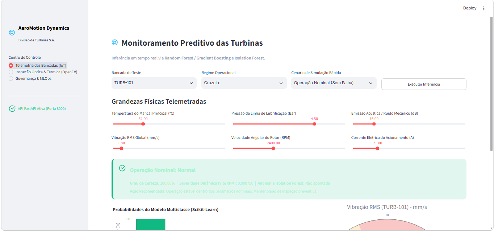
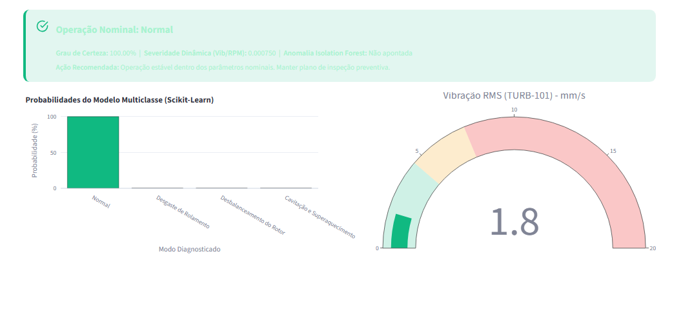
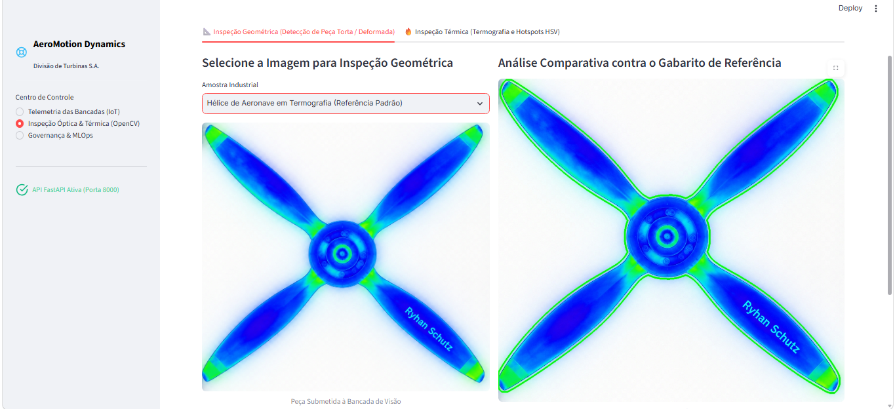
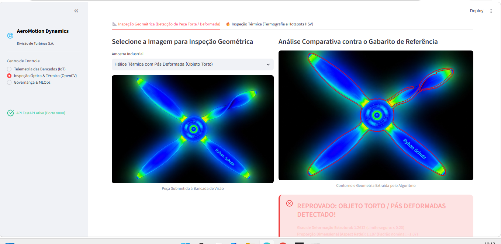
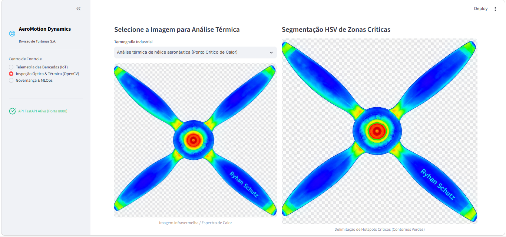

<div align="center">

# ✈️ AeroMotion Dynamics

### Central de IA e Análise Industrial — Divisão de Turbinas S.A.

[](https://python.org)
[](https://fastapi.tiangolo.com)
[](https://streamlit.io)
[](https://opencv.org)
[](https://scikit-learn.org)
[](LICENSE)

---

> Sistema ponta-a-ponta de **inteligência artificial preditiva** e **visão computacional industrial** para monitoramento de turbinas e inspeção automatizada de pás de aeronaves.

</div>

---

## 📖 Sobre

O projeto da **AeroMotion Dynamics S.A.** atende quatro bancadas de testes de desenvolvimento (`TURB-101` a `TURB-104`). A solução antecipa modos de falha críticos em rolamentos e rotores por meio de telemetria IoT em tempo real, além de automatizar o controle de qualidade geométrico e térmico de pás na linha de montagem com visão computacional.

### ⚙️ Principais Recursos

| Recurso | Descrição |
|---|---|
| 🧠 **Diagnóstico Preditivo Multiclasse** | Classificação dos modos operacionais: Normal · Desgaste de Rolamento · Desbalanceamento de Rotor · Cavitação/Superaquecimento |
| 🔍 **Detecção de Anomalias** | *Isolation Forest* treinado em dados nominais para flagrar desvios não catalogados |
| 👁️ **Visão Computacional (OpenCV)** | Inspeção geométrica via `cv2.matchShapes` + segmentação de hotspots no espaço de cor HSV |
| 🌐 **API RESTful (FastAPI)** | Microsserviço assíncrono pronto para integração com CLPs e supervisórios SCADA |
| 📊 **Dashboard (Streamlit)** | Centro de monitoramento web com ícones SVG industriais e métricas interativas |
| 📄 **Governança & MLOps** | Parecer técnico regulatório (LGPD, EU AI Act, IEC 62443) e plano de monitoramento de drift |

---

## 🖥️ Demonstração do Sistema

### 🎛️ Monitoramento Preditivo das Turbinas

Painel principal de telemetria IoT com sliders de grandezas físicas (temperatura, pressão, vibração, RPM, corrente e ruído acústico), inferência multiclasse em tempo real e gauge de vibração RMS.



---

### 📈 Diagnóstico e Gráficos de Saída

Resultado da inferência do modelo ensemble (Random Forest + Gradient Boosting) com gráfico de barras das probabilidades por classe e gauge de severidade dinâmica.



---

### 👁️‍🗨️ Inspeção Óptica & Térmica (OpenCV)

#### ✅ Inspeção Geométrica — Peça Aprovada

Comparação morfológica contra o gabarito de referência usando **Momentos de Hu** e `cv2.matchShapes`. Contornos verdes indicam conformidade dimensional.



---

#### ❌ Inspeção Geométrica — Peça Reprovada

Detecção automática de deformação nas pás. Contornos vermelhos indicam divergência morfológica significativa em relação ao gabarito padrão. **Status: REPROVADO — Pás deformadas detectadas.**



---

#### 🌡️ Análise Termográfica — Segmentação HSV

Segmentação automática de hotspots críticos de calor via espaço de cor HSV. Contornos verdes delimitam regiões com temperatura acima do limiar seguro (áreas > 200 px²).



---

## 📋 Requisitos

- **Python** 3.10 ou superior
- **Docker** e Docker Compose *(opcional, para implantação edge)*

### Principais Dependências

```
fastapi · uvicorn · streamlit · scikit-learn · opencv-python · numpy · pandas · joblib · plotly · matplotlib
```

---

## 🚀 Instalação

```bash
# 1. Clone o repositório
git clone https://github.com/seu-usuario/aeromotion-dynamics.git
cd aeromotion-dynamics

# 2. Crie e ative o ambiente virtual
python -m venv .venv

# Windows PowerShell:
.\.venv\Scripts\Activate.ps1

# Linux / macOS:
# source .venv/bin/activate

# 3. Instale as dependências
pip install -r requirements.txt
```

---

## ▶️ Uso

### Execução Local Rápida (Windows)

Execute o script em lote para iniciar a API e a interface web simultaneamente:

```cmd
scripts\iniciar-sistema.bat
```

### Execução Manual

Em terminais separados:

**1. API FastAPI:**
```bash
python -m uvicorn src.api.app:app --host 127.0.0.1 --port 8000
```
> 📍 Swagger UI: `http://127.0.0.1:8000/docs`

**2. Dashboard Streamlit:**
```bash
python -m streamlit run src/frontend/app.py --server.port 8501
```
> 📍 Painel Central: `http://127.0.0.1:8501`

### Execução com Docker (Edge Computing)

```bash
docker-compose up --build -d
```

---

## 🗂️ Estrutura do Projeto

```text
aeromotion-dynamics/
│
├── 📁 .github/workflows/         → Automações de CI/CD
│
├── 📁 assets/
│   ├── dados/                    → Telemetria e séries temporais originais
│   ├── imagens/                  → Amostras térmicas e ópticas para visão
│   ├── modelos/                  → Modelos treinados (.joblib) e scalers
│   └── prints/                   → Screenshots do sistema para documentação
│
├── 📁 docs/
│   ├── parecer-tecnico-*.pdf     → Relatório regulatório (LGPD, EU AI Act)
│   ├── parecer-tecnico-*.md      → Versão Markdown do parecer
│   └── notebook-treinamento.ipynb → Caderno de treino e EDA
│
├── 📁 scripts/
│   ├── iniciar-sistema.bat       → Launcher Windows (API + Streamlit)
│   └── gerar-pdf-parecer.py      → Gerador de PDF do parecer técnico
│
├── 📁 src/
│   ├── api/
│   │   └── app.py                → Microsserviço FastAPI (endpoints REST)
│   └── frontend/
│       └── app.py                → Dashboard Streamlit (monitoramento)
│
├── 📁 tests/
│   └── test_api.py               → Testes automatizados (unittest)
│
├── .editorconfig                 → Configuração de estilo de código
├── .gitignore                    → Regras de exclusão do Git
├── CHANGELOG.md                  → Histórico de mudanças (Keep a Changelog)
├── CONTRIBUINDO.md               → Guia de contribuição (Conventional Commits)
├── Dockerfile                    → Imagem de contêiner para deploy edge
├── docker-compose.yml            → Orquestração multi-contêiner
├── LICENSE                       → Licença MIT
├── README.md                     → Este arquivo
└── requirements.txt              → Dependências Python
```

---

## 🧪 Testes

```bash
python -m unittest discover -s tests -v
```

---

## 🤝 Contribuindo

Consulte o arquivo [CONTRIBUINDO.md](CONTRIBUINDO.md) para detalhes sobre fluxo de branches, padrões de código e mensagens de commit no formato **Conventional Commits**.

---

## 📄 Licença

Este projeto está licenciado sob os termos da licença [MIT](LICENSE).

---

<div align="center">

**AeroMotion Dynamics S.A.** — Divisão de Turbinas Industriais

*Monitoramento inteligente. Manutenção preditiva. Qualidade automatizada.*

</div>
